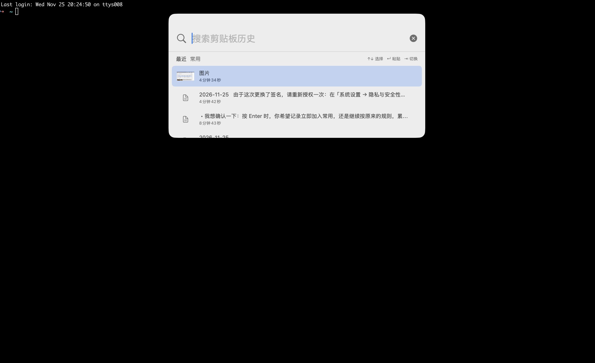

# ClipSpot

一个原生 macOS 菜单栏剪贴板工具，支持文本和 PNG/TIFF 图片。需要 macOS 13 或更新版本，以及安装了 Swift 的 Xcode 或命令行开发工具。

## 界面预览



## 安装

从 GitHub Releases 下载 DMG，打开后将 ClipSpot 拖到 Applications。安装包支持 Apple Silicon 和 Intel Mac，需要 macOS 13 或更新版本。此版本尚未经过 Apple 公证，首次打开时 macOS 可能阻止启动；可在“系统设置 → 隐私与安全性”中选择仍要打开。

## 构建和运行

```sh
./scripts/build-app.sh
open build/ClipSpot.app
```

应用不会出现在 Dock 中。首次选择历史记录时，请按提示在“系统设置 → 隐私与安全性 → 辅助功能”中允许 ClipSpot；授权后重新选择记录。建议将生成的 App 移到固定位置再授权，重新构建或移动后可能需要重新授权。构建脚本优先使用本机的 Apple Development 证书签名；可通过环境变量 `CLIPSPOT_SIGNING_IDENTITY` 指定证书。没有开发证书时使用临时签名，每次重新构建后可能需要重新授权。发布的构建产物尚未经过 Apple 公证。

## 使用

- 使用系统复制操作记录文本或图片。
- 按 `Control + V` 打开搜索面板；输入内容搜索，使用上下方向键选择，回车粘贴，Esc 关闭，Tab 在最近和常用间切换。
- 搜索框支持 `Control + A` 全选；按住 `Shift` 并使用方向键或点击可范围多选，回车后按列表顺序用换行符拼接粘贴。多选粘贴仅支持文本，图片请单独粘贴。
- 通过工具粘贴至少三次的记录会出现在常用中，常用最多显示最近的 99 条。每次复制或通过工具粘贴会更新记录时间，两个列表都按时间倒序排列。常用记录属于历史记录，历史记录被清除或达到上限淘汰时也会从常用中移除。
- 菜单栏剪贴板图标的下拉菜单提供打开、清除历史、设置记录上限和退出。默认最多 99 条，超出后删除最旧的记录。

## 数据和限制

数据保存在 `~/Library/Application Support/ClipSpot/`，不会上传。清除历史会删除保存的文本及图片，但不会清除系统当前剪贴板。工具会跳过带有常见密码管理器隐私标记的剪贴板内容，但无法保证识别所有敏感数据。仅保存每次复制的首个剪贴板项目，支持纯文本及 PNG/TIFF 数据；文件、富文本格式和其他图片表示暂不支持。搜索目前匹配文本和“图片”。模拟粘贴的成功与目标应用有关，计数表示工具发起了粘贴。`Control + V` 当前不可修改，若被占用可以通过菜单栏打开。

## 构建 DMG

```sh
./scripts/build-dmg.sh
```

生成的安装包位于 `build/ClipSpot-0.2.1.dmg`。
